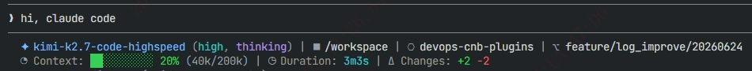
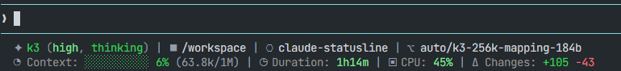
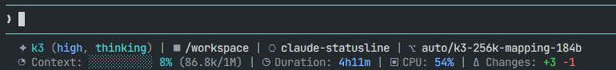

# cc-statusline

[](https://www.npmjs.com/package/@zlemon317/cc-statusline)
[](https://www.npmjs.com/package/@zlemon317/cc-statusline)
[](LICENSE)

A custom status line for Claude Code — shows model name, context usage, session duration, CPU utilization, repo name, git branch, and code change stats at a glance.

[中文说明](#中文说明)

classic theme:



matrix theme:



ocean theme:



## Features

- Current model name
- Model effort level and thinking mode status
- Context usage percentage with progress bar
- Automatic context-window mapping by model name (128k–2M; Qwen / DeepSeek / GLM / Kimi / MiniMax / GPT / Gemini / Grok; Claude uses the JSON-provided value)
- Session duration
- CPU utilization (Linux/Windows; hidden on macOS, which lacks `/proc/stat`)
- Current working directory and repository name
- Git branch
- Code change stats (added / removed lines)
- Switchable themes (classic / matrix / ocean)

## Installation

### Via npx (recommended)

```bash
npx @zlemon317/cc-statusline@latest
```

### Global install

```bash
# 1. Install the package
npm install -g @zlemon317/cc-statusline

# 2. Run the setup script
cc-statusline
```

The installer copies the status line script to `~/.claude/statusline.sh` (backing up any existing one) and writes the `statusLine` config into `~/.claude/settings.json`.

## Uninstall

```bash
npx @zlemon317/cc-statusline@latest --uninstall
```

Restores your previous status line from backup (or removes it) and cleans up `settings.json`.

## Dependencies

- `jq` — JSON processing (`apt install jq` / `yum install jq` / `brew install jq` / `winget install jqlang.jq`)
- `git` — branch and diff stats
- `bash` — required on Windows (ships with [Git for Windows](https://git-scm.com/download/win)); preinstalled on macOS/Linux

> **Windows note:** the installer locates `bash`, `jq`, and `git` via your `PATH`. Git for Windows' default setup only adds `Git\cmd` to `PATH`, which contains `git.exe` but **not** `bash.exe` — add `Git\usr\bin` to your `PATH` as well. After installing dependencies or editing `PATH`, open a **new** terminal window before running the installer (existing windows keep the old `PATH`).

## Themes

Edit `~/.claude/statusline.sh` and change the `THEME` variable:

```bash
THEME="classic"  # classic theme (blue)
THEME="matrix"   # matrix theme (green)
THEME="ocean"    # ocean theme (cyan)
```

Or set the `CC_STATUSLINE_THEME` environment variable — it survives reinstalls. Add it to the `env` section of `~/.claude/settings.json`:

```json
"env": {
  "CC_STATUSLINE_THEME": "matrix"
}
```

## Sample output

```
✦ kimi-k3 (high, thinking) | ◼ /workspace | ⎔ cc-statusline | ⌥ main
◔ Context: ████████░░ 82% (165k/1M) | ◷ Duration: 5m32s | ▣ CPU: 23% | Δ +128 -45
```

## Model context window mapping

The status line automatically matches the context window size by model name — no manual configuration needed:

| Model family | Context window |
|---------|-----------|
| qwen3.8-max-preview / qwen3.7-max / qwen3.7-plus / qwen3.7-flash / qwen3.6-plus / qwen3.6-flash | 1M |
| deepseek-v4-pro / deepseek-v4-flash | 1M |
| deepseek-v3.2 | 128k |
| glm-5.2 | 1M |
| glm-5.1 / glm-5 | 200k |
| kimi-k3 / k3 / k3[1m] | 1M |
| k3-256k | 256k |
| kimi-k2.7-code / kimi-k2.6 / kimi-k2.5 / kimi-for-coding (+ -highspeed variants) | 256k |
| kimi (legacy) | 128k |
| minimax-m3 | 1M |
| minimax-m2 / m2.5 / m2.7 | 204.8k |
| gpt-5.6 (sol / terra / luna) | 1.05M |
| gpt-5.5 | 1M |
| gpt-5 pro / 5.1 / 5.3 / 5.4 (codex) | 400k |
| gpt-4.1 | 1M |
| gpt-4o / gpt-4-turbo | 128k |
| gemini 3 / 3.1 (pro / flash) | 1M |
| grok-4.1-fast / grok-4.20 | 2M |
| grok-4.5 | 500k |
| grok-4.3 | 1M |
| grok-4 | 256k |
| claude (any) | JSON-provided value (200k standard / 1M beta) |
| Unknown models | JSON-provided value, else 200k (default) |

The mapping lives in the `get_model_context_window()` function in `bin/statusline.sh`. Model matching is case-insensitive. Priority: **name mapping > JSON-provided `context_window_size` > 200k default**. If your gateway uses different model names, just add a line to that function.

## Releasing

Publishing is automated via GitHub Actions (`.github/workflows/publish.yml`):

```bash
git tag v1.0.0
git push origin v1.0.0
```

The workflow syncs the `package.json` version from the tag and publishes to the public npm registry (requires an `NPM_TOKEN` repository secret).

## License

[MIT](LICENSE)

---

## 中文说明

Claude Code 自定义状态行工具，实时展示模型名称、上下文使用率、会话时长、CPU 使用率、代码仓库、Git 分支与代码变更统计等。

### 安装

```bash
npx @zlemon317/cc-statusline@latest
```

### 卸载

```bash
npx @zlemon317/cc-statusline@latest --uninstall
```

### 依赖

- `jq` - JSON 处理工具（`apt install jq` / `yum install jq` / `brew install jq` / `winget install jqlang.jq`）
- `git` - 版本控制工具
- `bash` - 仅 Windows 需要（随 [Git for Windows](https://git-scm.com/download/win) 提供）；macOS/Linux 已预装

> **Windows 提示：** 安装程序通过 `PATH` 查找 `bash`、`jq`、`git`。Git for Windows 默认安装只把 `Git\cmd` 加入 `PATH`（其中有 `git.exe` 但**没有** `bash.exe`），需手动将 `Git\usr\bin` 也加入 `PATH`。安装依赖或修改 `PATH` 后，请**重新打开终端窗口**再运行安装程序（已打开的窗口仍使用旧的 `PATH`）。

### 主题配置

编辑 `~/.claude/statusline.sh` 文件，修改 `THEME` 变量：

```bash
THEME="classic"  # 经典主题（蓝色系）
THEME="matrix"   # 矩阵主题（绿色系）
THEME="ocean"    # 海洋主题（青色系）
```

也可以设置 `CC_STATUSLINE_THEME` 环境变量——重装不会丢失。在 `~/.claude/settings.json` 的 `env` 中添加：

```json
"env": {
  "CC_STATUSLINE_THEME": "matrix"
}
```

### 示例输出

```
✦ kimi-k3 (high, thinking) | ◼ /workspace | ⎔ cc-statusline | ⌥ main
◔ Context: ████████░░ 82% (165k/1M) | ◷ Duration: 5m32s | ▣ CPU: 23% | Δ +128 -45
```

### 模型上下文窗口映射

状态行会按模型名称自动匹配上下文窗口大小（覆盖 128k / 200k / 256k / 400k / 500k / 1M / 2M，含 Qwen、DeepSeek、GLM、Kimi、MiniMax、GPT、Gemini、Grok 系列；Claude 直接使用 JSON 提供的准确值），映射规则位于 `bin/statusline.sh` 的 `get_model_context_window()` 函数中，模型匹配不区分大小写。优先级：**名称映射 > JSON 提供的 `context_window_size` > 200k 默认值**。如果你的网关使用不同的模型名，直接在该函数里加一行即可。

### 许可证

[MIT](LICENSE)
